# REFIT Washing Machine NILM — Appliance Disaggregation

## 1. Project Overview

This project explores and develops a Non-Intrusive Load Monitoring (NILM) approach to estimate washing-machine electricity consumption from aggregate household electricity readings.

The work uses the REFIT Electrical Load Measurements dataset and focuses on four households: Houses 1, 2, 6 and 7.

The project is divided into three main technical stages:

1. **Section 1 — Data Cleaning:** Inspection and cleaning of raw REFIT household readings.
2. **Section 2 — Exploratory Data Analysis:** Investigation of washing-machine usage, activation patterns, data availability and household differences.
3. **Section 3 — Appliance Disaggregation:** Training and evaluation of regression models to estimate washing-machine power from aggregate household power.

Section 4 discusses practical utility applications, limitations and deployment considerations.

### Project Objective

Given one-minute household aggregate power consumption, estimate the corresponding washing-machine power consumption in Watts.

The problem is formulated as a supervised regression task:

- Input: Household aggregate power and engineered aggregate-context features.
- Target: Washing-machine power consumption.
- Output: Estimated washing-machine active power at one-minute resolution.

---

## 2. Dataset and Household Selection

The project uses cleaned household data from the REFIT dataset.

The final modelling cohort consists of:

| House | Washing Machine Channel | Channel Mapping Source |
|---|---|---|
| House 1 | Appliance 5 | REFIT README |
| House 2 | Appliance 2 | REFIT README |
| House 6 | Appliance 2 | REFIT README |
| House 7 | Appliance 5 | REFIT README |

Channel assignments were obtained from the REFIT dataset README and were not independently verified through physical inspection.

### Household Selection Decisions

- Houses 1, 2, 6 and 7 were selected for the primary analysis.
- House 5 was excluded from the primary cohort because suspicious constant washing-machine readings were identified during data-quality analysis.
- Solar houses 3, 11 and 21 were excluded.
- Other households were not included in the final modelling cohort.

The primary results therefore represent four UK households and should not be treated as representative of all households.

---

## 3. Repository Structure

```text
refit-nilm/
│
├── README.md
├── DATA.md
├── RESULTS.md
├── Recommendation.md
├── recommendations.md
├── config.yaml
├── requirements.txt
│
├── data/
│   ├── raw/
│   ├── clean/
│   └── processed/
│       └── minute/
│
├── notebooks/
│   ├── 01_raw_house1_cleaning.ipynb
│   ├── 02_washing_machine_eda.ipynb
│   └── 03_model_colab.ipynb
│
├── src/
│   ├── data.py
│   ├── features.py
│   ├── models.py
│   ├── cycles.py
│   ├── metrics.py
│   ├── cleaning.py
│   ├── io.py
│   └── plotting.py
│
├── scripts/
│   ├── prepare_minute_data.py
│   ├── run_section3.py
│   ├── mask_wm_flat.py
│   ├── check_wm_flat.py
│   ├── check_wm_runs_in_parquet.py
│   └── section3_checks_tz.py
│
├── tests/
│
└── outputs/
    ├── figures/
    ├── tables/
    └── section3/
        ├── figures/
        ├── metrics_loho.csv
        ├── metrics_timesplit.csv
        ├── predictions_loho.parquet
        ├── predictions_timesplit.parquet
        ├── importance_loho.csv
        └── importance_timesplit.csv
```

The repository structure above describes the intended project organization. Check actual filenames when setting up from a fresh clone.

---

## 4. Dataset Access and Setup

### Data Requirements

The cleaned REFIT household CSV files are not redistributed as part of this repository.

Obtain the required REFIT data separately and place the cleaned files in:

```text
data/clean/
```

The primary modelling files are:

```text
CLEAN_House1.csv
CLEAN_House2.csv
CLEAN_House6.csv
CLEAN_House7.csv
```

House 5 was also inspected during exploratory household selection but was not included in the final primary modelling cohort.

Large raw datasets, cleaned CSV files and processed Parquet files should not be committed to the public GitHub repository unless their redistribution is explicitly permitted.

### Environment Setup

Python 3.11 was used in the development environment.

Create and activate a virtual environment:

```bash
python -m venv .venv

source .venv/bin/activate
```

Install dependencies:

```bash
pip install -r requirements.txt
```

Run the automated tests:

```bash
python -m pytest -q
```

The final recorded test result was:

```text
46 passed, 3 warnings
```

The warnings were Pandas timezone-aware Series `.values` deprecation warnings, not test failures.

---

## 5. Running the Project

The project contains notebooks and reusable Python scripts.

Recommended execution order:

### Step 1 — Data Cleaning

Open:

```text
notebooks/01_raw_house1_cleaning.ipynb
```

Execute the notebook sequentially to inspect and process the raw household readings.

### Step 2 — Exploratory Data Analysis

Open:

```text
notebooks/02_washing_machine_eda.ipynb
```

This notebook covers:

- Household selection and observation periods.
- Data availability and missing intervals.
- One-minute aggregation.
- Washing-machine power distributions.
- Activation episode detection.
- Sensitivity analysis.
- Hourly and weekly usage patterns.
- Cross-house duration and energy comparisons.

Generated figures and tables are stored under:

```text
outputs/figures/
outputs/tables/
```

### Step 3 — Prepare Model Data

The Section 3 preparation script is:

```bash
python scripts/prepare_minute_data.py
```

This creates the processed one-minute Parquet files used by the modelling workflow.

### Step 4 — Apply Stuck-Run Masking

After preparing the minute-level Parquet files, execute:

```bash
python scripts/mask_wm_flat.py
```

This masks selected suspicious constant non-zero washing-machine readings above 20 W.

**Important:** Flat-run masking is currently a separate operation and is not integrated into `prepare_minute_data.py`.

If minute Parquets are regenerated, the masking operation must be applied again before model training.

### Step 5 — Model Training and Evaluation

The full training and evaluation workflow was executed using Google Colab through:

```text
notebooks/03_model_colab.ipynb
```

The associated Python training script can also be invoked using:

```bash
python scripts/run_section3.py --experiments loho,timesplit
```

The full run uses the configuration in `config.yaml`.

The final experiments used the masked minute-level Parquet files.

Full training may require substantial memory and computation. Google Colab was used for the final experiments.

---

## 6. Data Preprocessing Decisions

Section 2 and Section 3 use different one-minute data preparation procedures.

### Section 2 — Exploratory Analysis

- Time-weighted one-minute aggregation.
- Primary analysis retained complete 60-second observations.
- Missing or incomplete minutes remained unavailable.
- Missing values were not treated as zero consumption.
- Usage comparisons were normalized using valid monitoring exposure.

### Section 3 — Model Preparation

- Per-minute mean aggregation.
- Short gaps of up to three minutes were filled.
- Identified stuck washing-machine sensor readings were masked as NaN.
- Point-level model evaluation used minutes where both aggregate and washing-machine readings were valid.

Therefore, coverage and valid-minute counts reported in Section 2 and Section 3 are not directly interchangeable.

### Time Handling

The final modelling decision was to keep CLEAN timestamps as stored:

```yaml
clean_time_zone: null
```

DST investigations identified missing and repeated UK local-clock hours around daylight-saving transitions.

The model's positive aggregate lags also use future-context readings, which means the present implementation is retrospective/offline rather than strictly real-time.

Further details are available in `DATA.md`.

---

## 7. Washing Machine Activation Detection

A common threshold-based rule was used for exploratory activation detection and cycle-level evaluation.

| Parameter | Final Value |
|---|---:|
| ON threshold | Above 20 W |
| OFF-gap merge tolerance | 5 observed minutes |
| Minimum episode duration | 27 minutes |
| Minimum energy | None |

An episode can contain short OFF periods when they are bounded by ON periods and satisfy the merge rule.

Missing or invalid minutes break episodes. They are never treated as zero-power observations or bridged.

These detected events are estimated activation episodes and are not guaranteed to represent complete physical washing cycles.

---

## 8. Model Development

The model predicts washing-machine power from aggregate household electricity consumption.

### Feature Engineering

The feature set includes:

- Current aggregate consumption.
- Aggregate lag features over a ±30-minute context.
- Rolling windows of 5, 15, 31 and 61 minutes.
- Rolling statistical features.
- A baseload estimate using a 60-minute rolling minimum.
- Aggregate-minus-baseload and difference features.

Time features were disabled in the final experiments.

Positive aggregate lags such as `agg_t+15`, `agg_t+20` and `agg_t+30` introduce future information. Therefore, the model is not directly suitable for strictly causal real-time prediction.

### Models Compared

Three simple baselines and two LightGBM regression models were evaluated.

| Model | Description |
|---|---|
| Always Off | Predicts zero washing-machine power |
| Training Mean | Predicts the training-set mean |
| Hourly Profile | Uses average training power by weekday and hour |
| LightGBM Tweedie | Regression using Tweedie objective |
| LightGBM L2 | Regression using L2 objective |

### Final LightGBM Configuration

| Parameter | Value |
|---|---:|
| Learning rate | 0.05 |
| Maximum estimators | 2,000 |
| Early stopping rounds | 100 |
| Number of leaves | 31 |
| Minimum child samples | 50 |
| Tweedie variance power | 1.5 |
| Training stride | 3 minutes |
| Test stride | 1 minute |

The final configuration is maintained in `config.yaml`.

---

## 9. Validation Strategy

Two evaluation strategies were used.

### Leave-One-House-Out (LOHO)

Each household was held out once for testing.

- Three households were used for training.
- Validation blocks were taken from the end of the training households' timelines.
- The held-out household was used for testing.

This evaluation examines generalization to an unseen household.

### Within-House Timesplit

Each household was evaluated independently.

- Earlier observations were used for training and validation.
- Later observations were held out for testing.
- The temporal split used a 70/30 design with an embargo.

Training used a stride of three minutes, whereas testing used all eligible minutes.

The two validation strategies have different test-set designs. Their aggregate scores should therefore not be treated as directly interchangeable.

### Evaluation Metrics

The following metrics were used:

- MAE (W).
- ON-state MAE (W).
- Relative energy error.
- Precision.
- Recall.
- F1 score.
- Cycle recall.
- Cycle precision.
- Cycle energy MAE.

Point-level metrics use valid observations where both aggregate and washing-machine readings are available.

Cycle-level metrics preserve the full-length timeline and unavailable intervals.

---

## 10. Final Model Results

### LOHO — Mean Across Test Households

| Model | MAE (W) | ON-state MAE (W) | Energy Error | F1 | Cycle Recall | Cycle Precision |
|---|---:|---:|---:|---:|---:|---:|
| Always Off | 18.447 | 443.348 | -1.000 | 0.000 | 0.000 | N/A |
| Hourly Profile | 34.518 | 418.269 | +0.582 | 0.105 | 0.711 | 0.200 |
| LightGBM L2 | 23.989 | 322.968 | +0.012 | 0.332 | 0.824 | 0.307 |
| LightGBM Tweedie | 17.973 | 362.787 | -0.595 | 0.414 | 0.592 | 0.513 |
| Training Mean | 35.049 | 425.333 | +0.584 | 0.018 | 0.500 | 0.366 |

### Timesplit — Mean Across Test Households

| Model | MAE (W) | ON-state MAE (W) | Energy Error | F1 | Cycle Recall | Cycle Precision |
|---|---:|---:|---:|---:|---:|---:|
| Always Off | 20.668 | 475.230 | -1.000 | 0.000 | 0.000 | N/A |
| Hourly Profile | 33.720 | 446.929 | -0.143 | 0.152 | 0.713 | 0.236 |
| LightGBM L2 | 23.059 | 264.428 | +0.203 | 0.371 | 0.924 | 0.348 |
| LightGBM Tweedie | 16.576 | 333.814 | -0.489 | 0.592 | 0.827 | 0.750 |
| Training Mean | 35.373 | 458.334 | -0.146 | 0.042 | 0.250 | 0.857 |

Negative energy error represents underestimation, while positive energy error represents overestimation under the reported evaluation convention.

### Model Selection

LightGBM Tweedie was selected as the primary candidate because it achieved:

- Better mean F1 score across both evaluation strategies.
- Better mean cycle precision.
- Better overall MAE than L2.

LightGBM L2 was retained as the secondary comparison because it achieved:

- Higher cycle recall.
- Lower ON-state MAE.
- Energy error closer to zero.

The Tweedie model still underestimates energy. Model selection therefore involves a trade-off between cycle precision, cycle recall and energy estimation.

MAE should not be used as the only headline metric because the large number of OFF minutes influences the overall score.

---

## 11. Failure Analysis and Limitations

### Household Generalization

LOHO performance varied considerably by household.

House 2 was the most challenging test household, with a Tweedie F1 score of approximately 0.165.

House 7 showed the strongest Tweedie F1 and cycle precision among the four held-out households.

This indicates that appliance behaviour differs across homes and limits straightforward transfer of one household's learned patterns to another.

### Energy Estimation

The Tweedie model underestimated total energy in both evaluation strategies:

- LOHO energy error: -0.595.
- Timesplit energy error: -0.489.

Its estimates should not be used directly for billing or guaranteed energy-savings claims.

### Cycle Detection

L2 achieved higher cycle recall but also predicted substantially more cycles in some households.

For House 7 in LOHO, L2 produced 2,157 predicted cycles compared with 876 true cycles.

This demonstrates the trade-off between identifying more actual events and introducing false detections.

### Data Quality

The REFIT observations contain missing monitoring intervals and suspicious stuck-value readings.

The selected washing-machine flat-run mask was applied separately from the preparation script. This is a reproducibility limitation.

---

## 12. Visual Results

The generated figures are stored in the `outputs/` directory.

### Section 1 — Cleaning and Signal Analysis

- `outputs/figures/section1_before_after.png`
- `outputs/figures/house1_before_after_day.png`
- `outputs/figures/house1_outage_timeline.png`
- `outputs/figures/wm_power_distribution.png`
- `outputs/figures/wm_power_distribution_1min.png`
- `outputs/figures/wm_power_ecdf.png`
- `outputs/figures/wm_power_ecdf_1min.png`
- `outputs/figures/wm_low_power_ecdf_1min.png`

### Section 2 — Exploratory Data Analysis

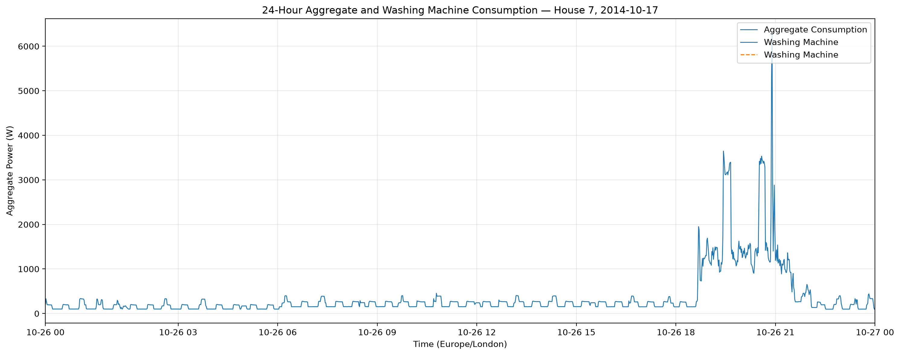

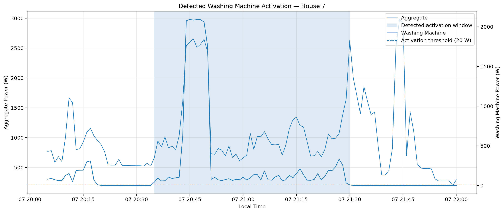

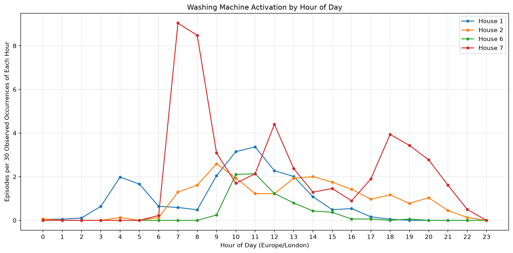

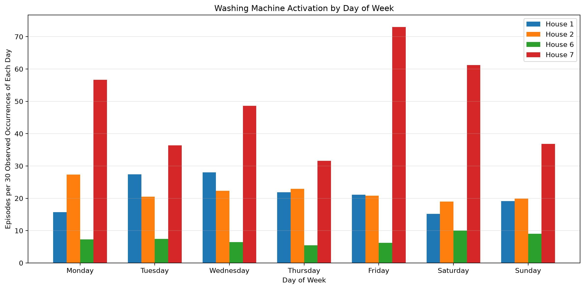

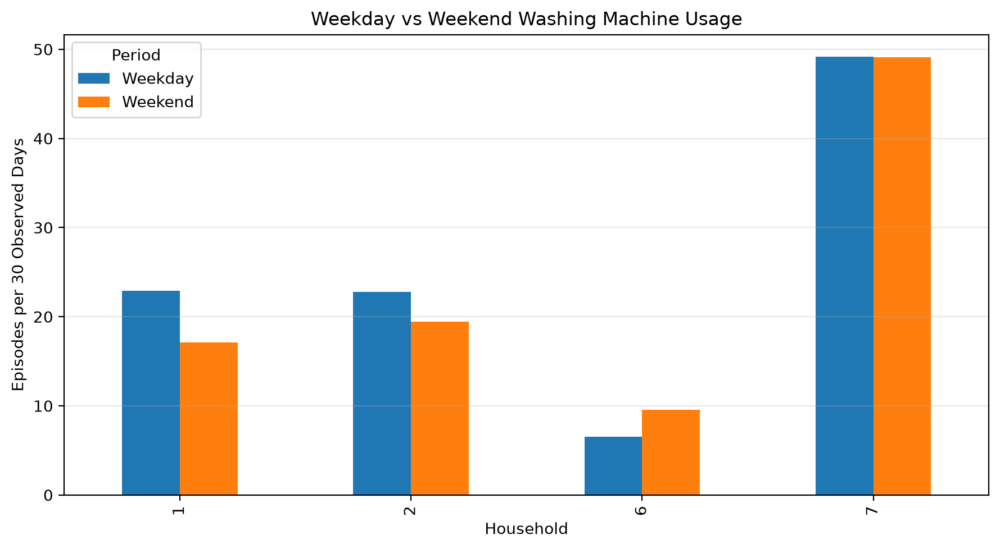

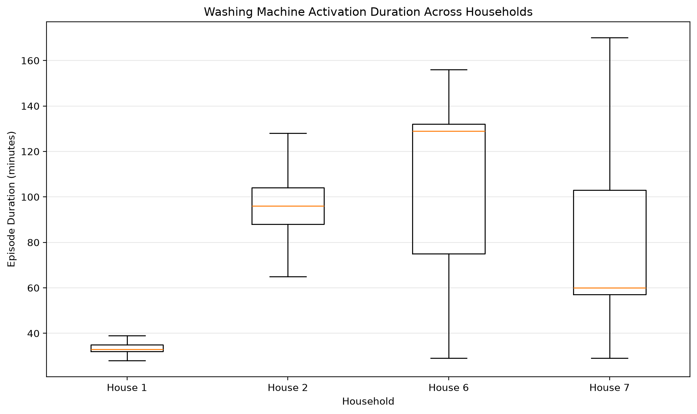

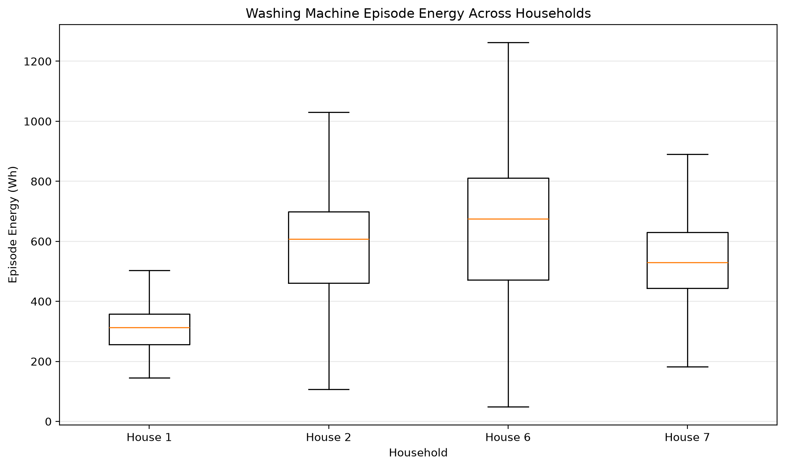

### Section 3 — Model Evaluation

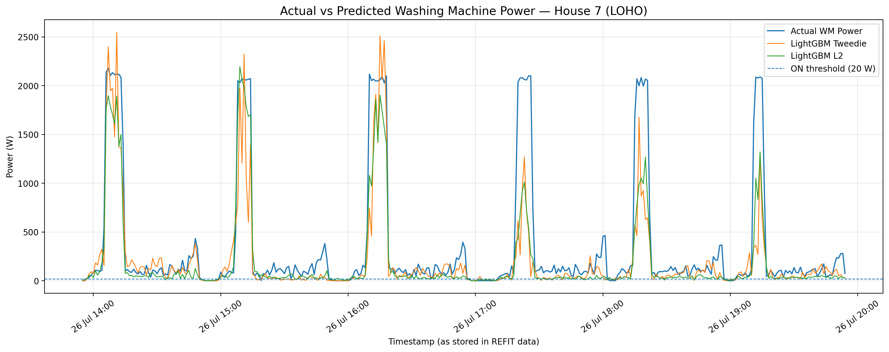

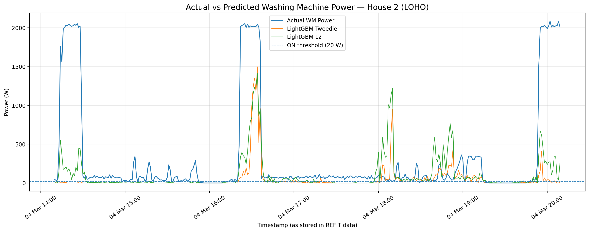

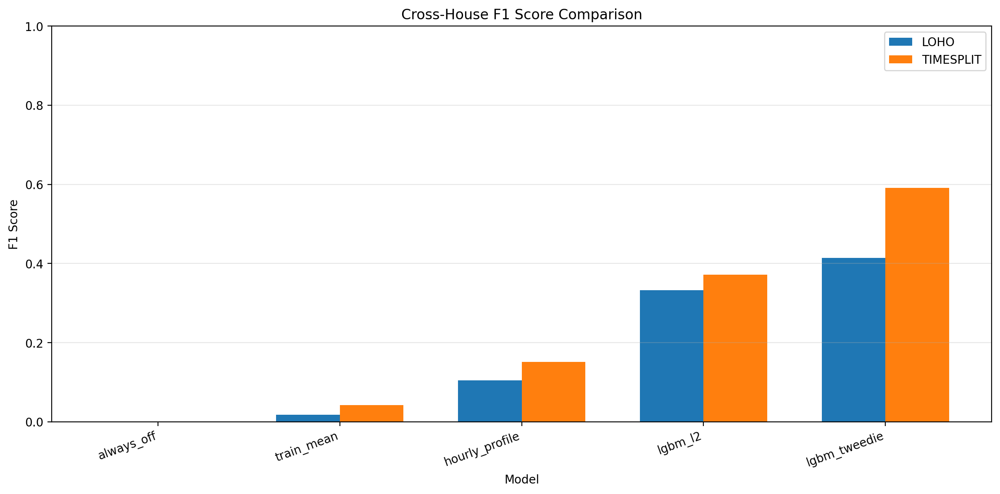

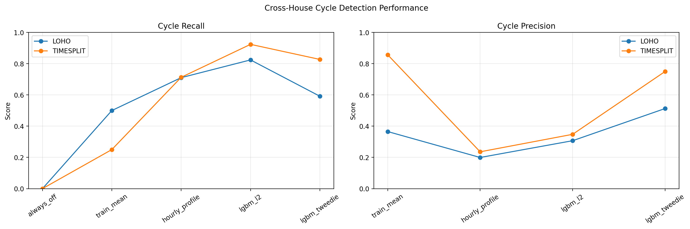

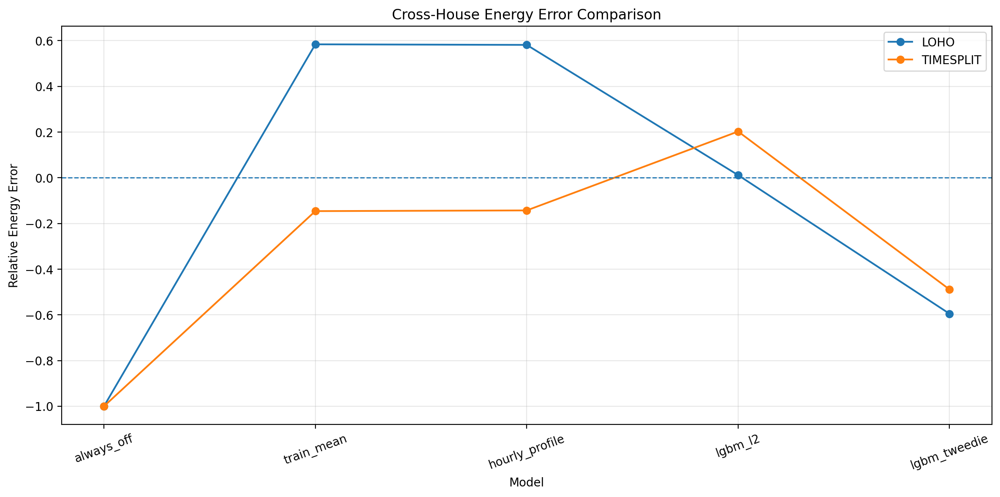

---

## 13. Practical Application

A realistic initial utility application is a customer-facing usage-insight summary.

A utility could provide participating households with a weekly estimate of washing-machine activation frequency and typical usage times.

This could help customers understand their routines and identify opportunities to reduce unnecessary cycles or consolidate loads.

The current model is intended for exploratory customer insights, not billing-grade appliance monitoring.

A pilot should compare participating households receiving feedback with a comparable group that does not receive feedback.

Success should be measured using independently validated washing-machine energy consumption in kWh per household-week and washing-machine cycles per household-week.

The current project does not establish that the intervention will save energy. The proposed pilot would test that outcome.

---

## 14. Deployment Limitations

- Aggregate household readings combine multiple appliances, leading to overlapping and ambiguous signatures.
- Missing observations and sensor-quality issues affect monitoring coverage.
- The evaluation cohort contains only four UK homes.
- Household usage characteristics differ.
- Applying the model to Indian homes is untested and requires local data collection and validation.
- The use of future aggregate lags prevents strictly real-time causal prediction.
- At 15-minute or 30-minute resolution, transient power peaks and cycle boundaries would be smoothed. A separately trained and evaluated model would be required.

---

## 15. AI Tools Used

AI-assisted tools were used during the project for methodological discussion, debugging support, code explanations, documentation drafting and interpretation of selected results.

ChatGPT and Claude were used as assistance tools.

All reported numerical results were generated from the project's executed Python code and saved model outputs. AI-generated suggestions were reviewed against the actual implementation and results.

---

## 16. Possible Improvements

Future work includes:

1. Integrating stuck washing-machine sensor masking directly into the reproducible data-preparation pipeline.
2. Evaluating gain-based feature importance in addition to split importance.
3. Performing a time-feature ablation study.
4. Exploring additional Tweedie configurations and estimator limits.
5. Removing positive aggregate lags and evaluating a strictly causal model.
6. Improving energy estimation through calibration and additional validation.
7. Investigating weak generalization on House 2.
8. Testing the approach on additional REFIT households.
9. Collecting and validating Indian household data before local deployment.
10. Evaluating performance using 15-minute and 30-minute smart-meter readings.

---

## 17. Reproducibility and Testing

The automated test suite was executed using:

```bash
python -m pytest -q
```

Final recorded result:

```text
46 passed, 3 warnings
```

The three warnings were Pandas timezone-aware Series `.values` deprecation warnings.

Additional documentation is available in:

- `DATA.md` — Data coverage, cleaning, gaps, time handling and preprocessing decisions.
- `RESULTS.md` — Detailed EDA, model evaluation, plots and failure analysis.
- `Recommendation.md` — Utility-facing executive recommendation.
- `recommendations.md` — Technical recommendations and deferred experiments.

---

## 18. Final Model Configuration

The final modelling cohort and principal settings are maintained in `config.yaml`.

The selected primary candidate is LightGBM Tweedie, with LightGBM L2 retained as a secondary comparison.

The current results are exploratory and should be validated on additional households before operational deployment.