# RESULTS — REFIT Washing-Machine NILM

## 1. Scope and data

The task estimates washing-machine (WM) active power from household aggregate power at one-minute resolution. The analysed cohort contains REFIT Houses 1, 2, 6 and 7.

| House | WM channel | Section 2 observation period (Europe/London) | Section 2 coverage |
|---|---|---|---:|
| 1 | Appliance 5 | 2013-10-09 to 2015-07-10 | 87.26% |
| 2 | Appliance 2 | 2013-09-17 to 2015-05-28 | 75.27% |
| 6 | Appliance 2 | 2013-11-28 to 2015-06-28 | 84.80% |
| 7 | Appliance 5 | 2013-11-01 to 2015-07-08 | 87.38% |

Channel assignments are from the REFIT README and were not independently physically verified. House 5 was excluded from the primary cohort because suspicious constant WM readings were found in Section 2. Solar houses 3, 11 and 21 were excluded. House 12's WM availability and House 13's relevance to this project were not independently rechecked for this modelling run.

**Preparation distinction:** Section 2 used time-weighted one-minute aggregation and retained complete 60-second observations for primary analysis. Section 3 used per-minute mean aggregation, filled short gaps up to three minutes, and applied a separate stuck-WM-run mask. Accordingly, Section 2 and Section 3 valid-minute counts and missing percentages are not directly interchangeable.

## 2. Section 2 — exploratory analysis

### 2.1 Data coverage and quality

| House | Valid complete minutes | Coverage | Missing intervals | Total missing hours | Longest gap |
|---|---:|---:|---:|---:|---:|
| 1 | 802,848 | 87.26% | 611 | 1,953.87 | 59,908 min (41.60 days) |
| 2 | 669,206 | 75.27% | 571 | 3,664.37 | 89,316 min (62.02 days) |
| 6 | 705,099 | 84.80% | 421 | 2,106.63 | 48,327 min (33.56 days) |
| 7 | 771,495 | 87.38% | 322 | 1,858.07 | 59,908 min (41.60 days) |

Longest gaps observed:

| House | Gap start (London) | Gap end (London) |
|---|---|---|
| 1 | 2014-01-24 01:56 | 2014-03-06 16:23 |
| 2 | 2013-10-25 13:09 | 2013-12-26 12:44 |
| 6 | 2014-02-01 02:57 | 2014-03-06 16:23 |
| 7 | 2014-01-24 01:56 | 2014-03-06 16:23 |

Missing intervals are unavailable observations, not zero consumption.

### 2.2 Zero, OFF and active time

The EDA state definitions were exactly 0 W for zero power, <=20 W for OFF, and >20 W for active. Percentages below use valid complete-minute observations.

| House | Zero power | OFF (<=20 W) | Active (>20 W) | Issues-affected minutes |
|---|---:|---:|---:|---:|
| 1 | 97.53% | 98.10% | 1.90% | 2.23% |
| 2 | 94.38% | 95.29% | 4.71% | 2.23% |
| 6 | 97.41% | 98.12% | 1.88% | 2.30% |
| 7 | 74.50% | 91.62% | 8.38% | 4.90% |

House 7 has the highest observed active-time share and the highest Issues-affected share. Its 8.38% is active time, **not missing data**. Section 2 coverage implies 12.62% missing/incomplete bins for House 7; Section 3's separate pipeline gives approximately 13.14% unavailable after its preparation/masking. The row-level reason for the approximately 0.52 percentage-point difference has not been reconciled.

### 2.3 Activation rule and cycle summary

Section 2's estimated activation-episode rule was: WM power strictly above 20 W; merge up to five consecutive observed OFF minutes when bounded by ON runs; retain merged spans of at least 27 minutes; no minimum energy filter. Missing/invalid minutes break episodes and are never bridged. Issues-flagged readings were retained and flagged rather than automatically removed. These are estimated activation episodes, not verified physical wash cycles.

| House | Detected episodes | Median duration | Mean duration | P90 duration | Median episode energy | Median peak power |
|---|---:|---:|---:|---:|---:|---:|
| 1 | 395 | 33 min | 40.45 min | 64.6 min | 312.79 Wh | 2,321.87 W |
| 2 | 338 | 96 min | 97.60 min | 131.2 min | 607.21 Wh | 2,088.90 W |
| 6 | 121 | 129 min | 105.71 min | 139.0 min | 674.99 Wh | 2,049.18 W |
| 7 | 878 | 60 min | 73.53 min | 111.0 min | 529.82 Wh | 2,080.82 W |

A cycle-duration range and mean cycles per week were not supplied in the verified outputs and are therefore not reported here.

### 2.4 Temporal usage patterns

Peak normalized hour-of-day rates were at 11:00 for House 1 (3.36 episodes per 30 observed occurrences of that hour), 09:00 for House 2 (2.59), 11:00 for House 6 (2.14), and 07:00 for House 7 (9.04). Peak weekdays were Wednesday for House 1 (28.04 episodes per 30 observed occurrences of that weekday), Monday for House 2 (27.31), Saturday for House 6 (10.02), and Friday for House 7 (73.03). The patterns differ across households; rates are exposure-normalized, not raw counts.

### 2.5 Section 2 figures

All paths below are relative to the project root:

| Figure | Path | What it shows |
|---|---|---|
| Representative 24-hour trace | `outputs/figures/representative_24h_trace.png` | Aggregate and WM power across one complete local calendar day. |
| Representative activation episode | `outputs/figures/representative_activation_episode.png` | Aggregate and WM power around one detected activation episode. |
| Hourly usage | `outputs/figures/hourly_usage_patterns.png` | Exposure-normalized activation starts by hour. |
| Weekday usage | `outputs/figures/weekday_usage_patterns.png` | Exposure-normalized activation starts by weekday. |
| Weekday vs weekend | `outputs/figures/weekday_vs_weekend_usage.png` | Exposure-normalized weekday/weekend comparison. |
| Duration comparison | `outputs/figures/cross_house_duration_comparison.png` | Cross-house distribution of detected episode duration. |
| Energy comparison | `outputs/figures/cross_house_energy_comparison.png` | Cross-house distribution of estimated episode energy. |

Section 2 tables include `outputs/tables/detected_activations.csv`, `cycle_summary_by_house.csv`, `cross_house_cycle_summary.csv`, `final_data_quality_summary.csv`, `final_episode_summary.csv`, `final_temporal_summary.csv`, `household_periods_and_quality.csv`, and `missing_gap_details.csv`.

## 3. Section 3 — model and validation

### 3.1 Model setup

Input: aggregate household power and engineered aggregate-context features. Target: WM power in W. Houses: 1, 2, 6 and 7. WM channels: H1 Appliance 5, H2 Appliance 2, H6 Appliance 2, H7 Appliance 5.

Feature choices included aggregate lags over a +/-30-minute context, rolling windows of 5, 15, 31 and 61 minutes, a baseload estimate using a 60-minute rolling minimum, and related aggregate-minus-baseload/difference features. Time features were disabled. Because positive aggregate lags such as `agg_t+30` are used, this is a retrospective/offline model, not a strictly causal real-time model.

The final LightGBM configuration used learning rate 0.05, up to 2,000 estimators, early stopping after 100 rounds, 31 leaves, 50 minimum child samples, and Tweedie variance power 1.5 for the Tweedie objective. The compared objectives were Tweedie and L2 regression. Baselines were Always Off, Training Mean and Hourly Profile.

### 3.2 Evaluation design

- **LOHO:** leave one household out for testing; train on the other three households, with a validation block taken from the end of each training household's timeline.
- **Timesplit:** train/validate on the earlier portion and test on the later portion of each household; the stated split was 70/30 with an embargo.
- Training used stride 3; test evaluation used all eligible minutes.
- Point metrics use minutes where aggregate and WM target are both valid. Cycle metrics retain the full-length timeline and preserve NaN gaps.

The two evaluation strategies have different test-set designs, so their aggregate scores are not a like-for-like comparison.

### 3.3 Final masked-data valid-minute counts

| House | Total minute bins | Valid minutes |
|---|---:|---:|
| 1 | 920,091 | 801,279 |
| 2 | 889,078 | 663,642 |
| 6 | 831,480 | 699,618 |
| 7 | 882,970 | 766,991 |

The final flat-run masking added 224 unavailable WM minutes in House 1, 44 in House 2, 0 in House 6 and 2 in House 7. The mask was applied to prepared Parquet files using `scripts/mask_wm_flat.py`; it is not integrated into `scripts/prepare_minute_data.py`, so rerunning preparation requires reapplying the mask.

The native/Parquet WM flat-run audit used the rule: constant non-zero value, at least 30 minutes and at least 20 readings. The reported check found 10 runs in House 1 (5 above 20 W), 5 in House 2 (1 above 20 W; 92 W for 44 minutes), 27 in House 6 (all at 1 W), and 2 in House 7 (1 above 20 W). A prior Section 2 note recorded 28 House 6 runs; the 27-versus-28 discrepancy was not explained. The decision to mask selected non-zero flat runs above 20 W as stuck sensor values is an inference, not independently verified ground truth. Two joint aggregate/WM plateau windows were already NaN: House 1 on 2015-02-08 13:24–16:12 (2,256 W) and House 7 on 2014-10-04 15:27–17:05 (2,178 W).

### 3.4 Mean results across test households

**LOHO**

| Model | MAE (W) | ON-state MAE (W) | Energy error | F1 | Cycle recall | Cycle precision |
|---|---:|---:|---:|---:|---:|---:|
| Always Off | 18.447 | 443.348 | -1.000 | 0.000 | 0.000 | N/A |
| Hourly Profile | 34.518 | 418.269 | +0.582 | 0.105 | 0.711 | 0.200 |
| LightGBM L2 | 23.989 | 322.968 | +0.012 | 0.332 | 0.824 | 0.307 |
| LightGBM Tweedie | 17.973 | 362.787 | -0.595 | 0.414 | 0.592 | 0.513 |
| Training Mean | 35.049 | 425.333 | +0.584 | 0.018 | 0.500 | 0.366 |

**Timesplit**

| Model | MAE (W) | ON-state MAE (W) | Energy error | F1 | Cycle recall | Cycle precision |
|---|---:|---:|---:|---:|---:|---:|
| Always Off | 20.668 | 475.230 | -1.000 | 0.000 | 0.000 | N/A |
| Hourly Profile | 33.720 | 446.929 | -0.143 | 0.152 | 0.713 | 0.236 |
| LightGBM L2 | 23.059 | 264.428 | +0.203 | 0.371 | 0.924 | 0.348 |
| LightGBM Tweedie | 16.576 | 333.814 | -0.489 | 0.592 | 0.827 | 0.750 |
| Training Mean | 35.373 | 458.334 | -0.146 | 0.042 | 0.250 | 0.857 |

Negative energy error indicates underestimation and positive error indicates overestimation, according to the reported result interpretation. The exact implementation formula should be checked in `src/metrics.py` before reusing the metric outside this evaluation.

### 3.5 Model selection and trade-offs

LightGBM Tweedie is the selected primary model because it has the best mean F1, cycle precision and overall MAE in both reported evaluation strategies. LightGBM L2 is retained as a secondary comparison: it has higher cycle recall, lower ON-state MAE and energy error closer to zero.

The Tweedie model underestimates energy (LOHO -0.595; Timesplit -0.489). L2 tends to produce more detected cycles in some households; for House 7 LOHO it produced 2,157 predicted cycles against 876 true cycles. MAE is heavily influenced by OFF minutes and should not be used as the only headline metric. Training Mean cycle metrics can be degenerate because a constant prediction near/above the 20 W threshold can create always-ON behaviour; interpret those baseline cycle metrics cautiously.

### 3.6 Per-house LOHO outcomes

| House | Model | F1 | Cycle recall | Cycle precision | Energy error |
|---|---|---:|---:|---:|---:|
| 1 | Tweedie | 0.432 | 0.476 | 0.525 | -0.717 |
| 1 | L2 | 0.268 | 0.877 | 0.312 | -0.160 |
| 2 | Tweedie | 0.165 | 0.145 | 0.333 | -0.821 |
| 2 | L2 | 0.243 | 0.463 | 0.287 | -0.196 |
| 6 | Tweedie | 0.495 | 0.926 | 0.548 | -0.322 |
| 6 | L2 | 0.291 | 0.967 | 0.188 | +0.424 |
| 7 | Tweedie | 0.564 | 0.821 | 0.646 | -0.521 |
| 7 | L2 | 0.527 | 0.990 | 0.442 | -0.022 |

House 2 is the most challenging LOHO test household in these results. House 7 has the strongest Tweedie F1 and cycle precision among the four LOHO houses.

### 3.7 Prediction and comparison figures

All paths are relative to `outputs/section3/`:

| Figure | Path | What it shows |
|---|---|---|
| House 7 LOHO trace | `figures/prediction_vs_actual_loho_house7.png` | Actual WM power vs Tweedie and L2 over a selected six-hour high-activity window (2014-07-26 13:55–19:54 as stored). |
| House 2 LOHO trace | `figures/prediction_vs_actual_loho_house2.png` | Actual WM power vs Tweedie and L2 over a selected six-hour high-activity window (2015-03-04 14:09–20:09 as stored). |
| Cross-house F1 | `figures/cross_house_f1_comparison.png` | Mean F1 by model for LOHO and Timesplit. |
| Cycle metrics | `figures/cross_house_cycle_metrics.png` | Mean cycle recall and precision by model and experiment. |
| Energy error | `figures/cross_house_energy_error.png` | Mean energy error by model and experiment. |

The six-hour windows are selected diagnostic examples, not full test-period summaries.

### 3.8 Feature importance

Feature importance was obtained from LightGBM's `feature_importances_` property. No `importance_type` override was found in `src/models.py` or `config.yaml`; LightGBM's default is split-based importance. Therefore, the CSV values represent feature split counts, not gain.

Tweedie repeatedly ranked 61-minute rolling statistics (`roll61_max`, `roll61_min`, `roll61_std`) highly. L2 often ranked aggregate lag features (`agg_t-30`, `agg_t+30`, `agg_t-20`, `agg_t+20`) highly. Both models use surrounding aggregate context. Positive aggregate lags use future-context readings and limit strictly real-time deployment.

## 4. Practical implications

### 4.1 Opportunity for a utility

A realistic first use is a **customer usage-insight summary**, rather than automated billing or fault diagnosis. A utility could offer participating households a weekly view of estimated WM activation frequency and typical usage times. This could help customers understand their appliance-use routines and identify opportunities to reduce unnecessary cycles or consolidate loads. The model's absolute energy estimates should be labelled as estimates: Tweedie underestimates energy in both reported evaluations, and performance varies substantially by household.

A pilot should compare an opt-in feedback group with a comparable group that does not receive the feedback. Measure (1) WM kWh per household-week using an independent appliance meter or validated submeter, (2) WM cycles per household-week, and (3) the change in those measures from a pre-intervention baseline. Report results per household and account for differences in observation coverage. Validate model-estimated energy against the independent meter before using it to quantify savings. The current results do not establish that feedback will save energy; that is the proposed outcome to test.

### 4.2 Limitations

- **Overlapping appliance signatures:** Aggregate power contains the combined demand of multiple appliances. Simultaneous appliance operation can produce overlapping or ambiguous signatures, so aggregate-only inputs do not always identify WM power uniquely.
- **Missing data and sensor quality:** Section 2 coverage ranged from 75.27% to 87.38%, with longest continuous gaps of about 33.56 to 62.02 days. Section 3 fills short gaps and masks selected stuck WM readings, but its preparation differs from Section 2. Missing values are not evidence of zero consumption.
- **Household differences:** The four-house cohort is small and usage patterns differ. LOHO Tweedie F1 ranged from 0.165 in House 2 to 0.564 in House 7, showing uneven generalization to an unseen household.
- **UK-to-India transfer:** The model was developed on four UK REFIT homes only. Appliance models and programmes, household routines, installation/metering characteristics, occupancy and usage patterns may differ in Indian homes. Performance in India is unknown and would require local data, channel/label verification and validation before deployment. This is a domain-transfer inference, not a result measured in REFIT.
- **Retrospective context:** Positive aggregate lags use future readings, so current features are not suitable for a strictly real-time service without redesign and reevaluation.
- **Energy bias:** The selected Tweedie model underestimates total energy in both evaluation strategies. Do not use its raw energy estimate for billing, guaranteed savings claims or customer disputes without calibration and independent validation.

### 4.3 If only 15-minute or 30-minute smart-meter data were available

At 15- or 30-minute resolution, short power changes and the internal stages of a washing-machine cycle would be averaged into much larger intervals. Peak power would be smoothed, cycle start and end times would be less precise, and shorter activations could be diluted or merged with other appliance demand. Overlapping appliance signatures would become harder to separate, while the current one-minute 20 W activation threshold and lag/rolling features could not simply be reused. A model would need to be redesigned and trained/evaluated at the coarser resolution, with lower temporal precision expected. This is a methodological inference; no 15- or 30-minute experiment was run.

## 5. Reproducibility and outstanding work

- `python -m pytest -q`: 46 passed, 3 Pandas timezone-aware `.values` deprecation warnings.
- Flat-run masking is a separate script and is not integrated into `prepare_minute_data.py`; the mask must be reapplied after regenerating minute Parquets.
- `recommendations.md` documents deferred experiments, including time-feature ablation, gain-based importance, further Tweedie tuning and causal feature evaluation.
- The House 7 Section 2/Section 3 missing-percentage difference has not been reconciled row by row.
- The missing CLEAN observations at hour 00 on 2014-03-30 have not been explained.
- Public GitHub publication status is not verified in this document.

## Embedded Figures — Visual Results

### Section 2 — Exploratory Data Analysis

#### Figure 1. Representative 24-hour household trace

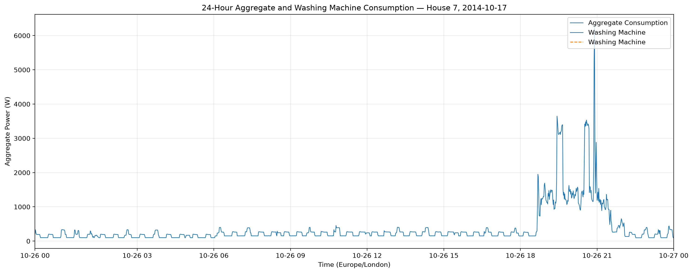

Shows aggregate household power alongside washing-machine power over a representative local calendar day.

#### Figure 2. Representative detected activation episode

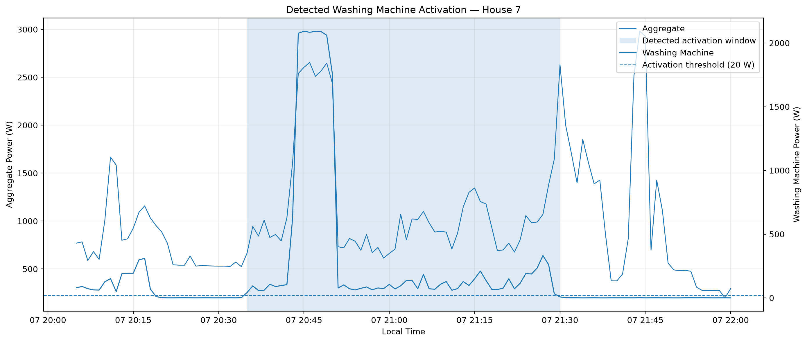

Shows the aggregate and appliance power around a detected washing-machine activation episode.

#### Figure 3. Hour-of-day usage pattern

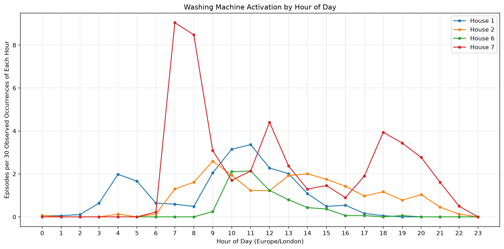

Compares exposure-normalized washing-machine activation frequency across the 24 hours of the day.

#### Figure 4. Day-of-week usage pattern

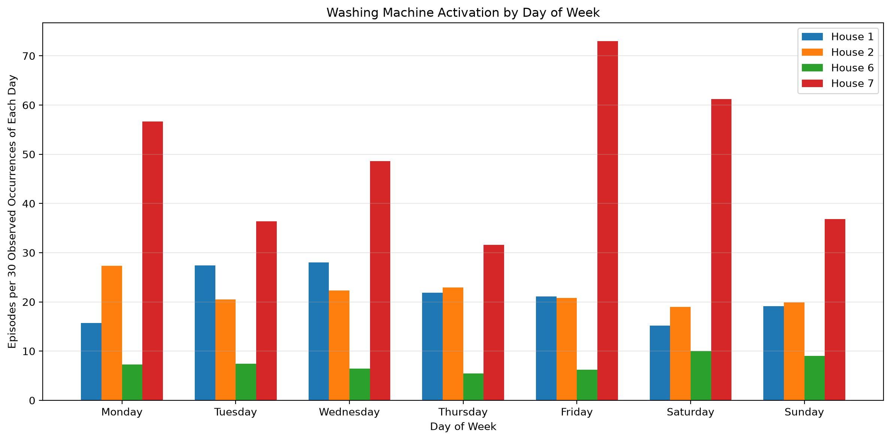

Compares exposure-normalized activation frequency across the seven weekdays.

#### Figure 5. Weekday versus weekend

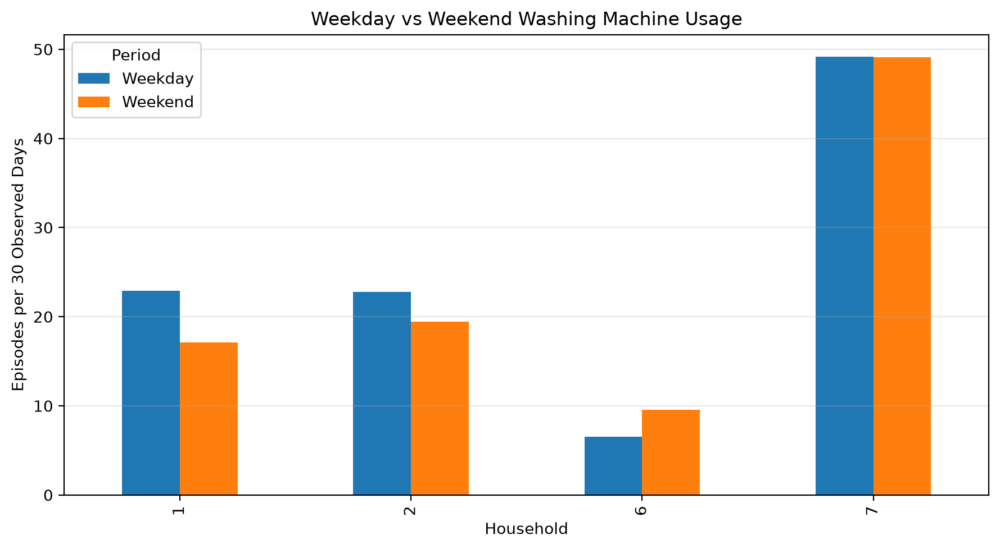

Compares normalized activation frequency between weekdays and weekends.

#### Figure 6. Cross-house activation duration

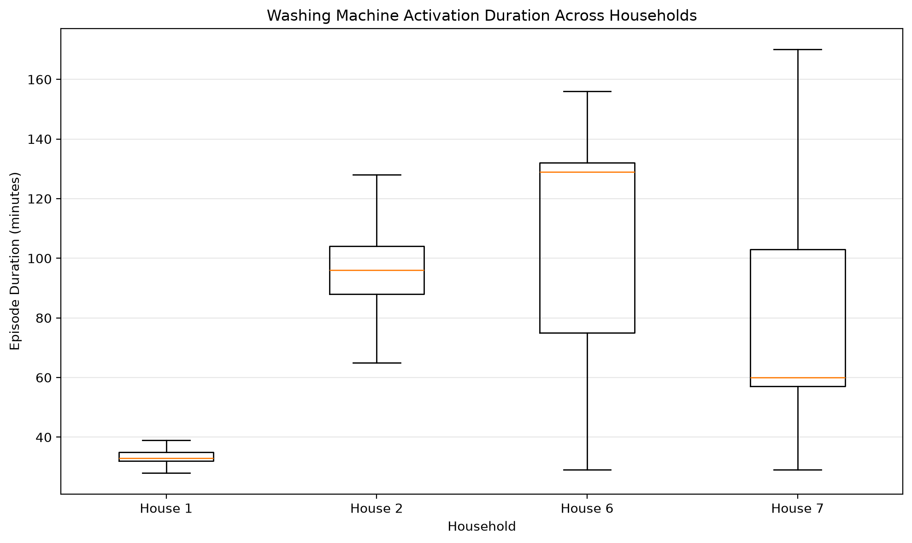

Compares estimated activation episode duration distributions across the four households.

#### Figure 7. Cross-house episode energy

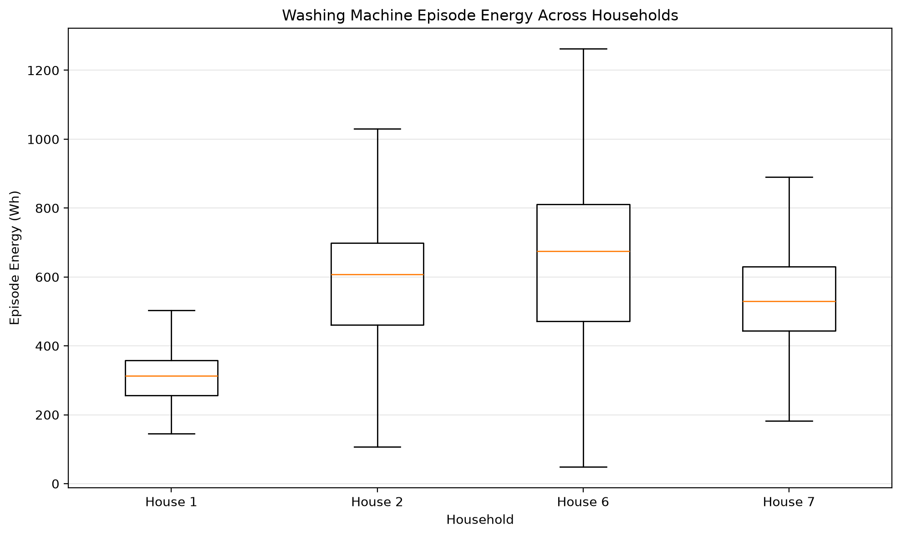

Compares estimated energy per detected activation episode across the four households.

### Section 3 — Model Evaluation

#### Figure 8. Actual versus predicted power — House 7 (LOHO)

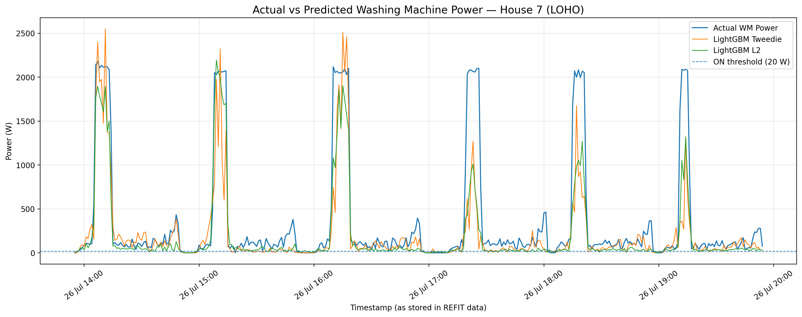

Shows actual washing-machine power against LightGBM Tweedie and L2 predictions over a selected six-hour high-activity window.

#### Figure 9. Actual versus predicted power — House 2 (LOHO)

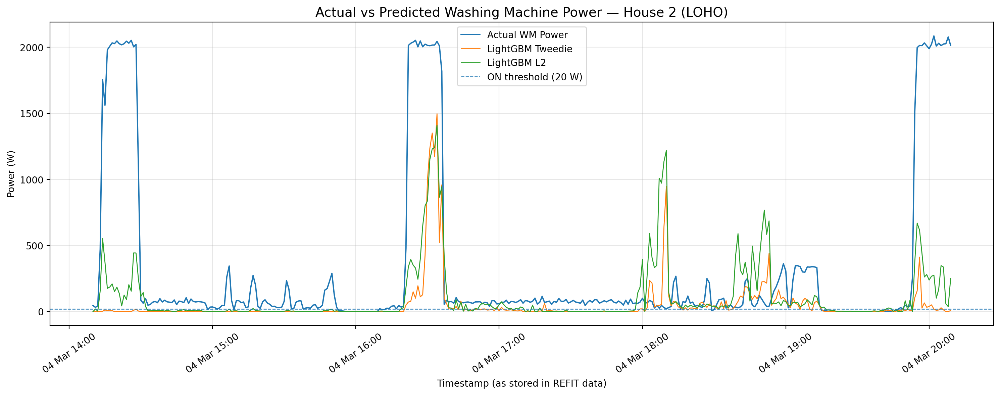

Shows model predictions for a more challenging unseen household.

#### Figure 10. Cross-house F1 comparison

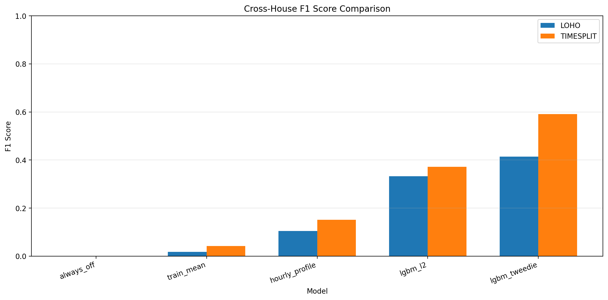

Compares mean F1 scores across models under LOHO and Timesplit evaluation.

#### Figure 11. Cross-house cycle metrics

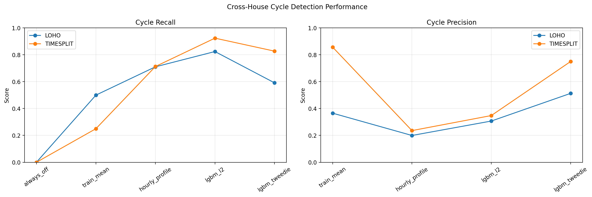

Compares mean cycle recall and cycle precision across models.

#### Figure 12. Cross-house energy error

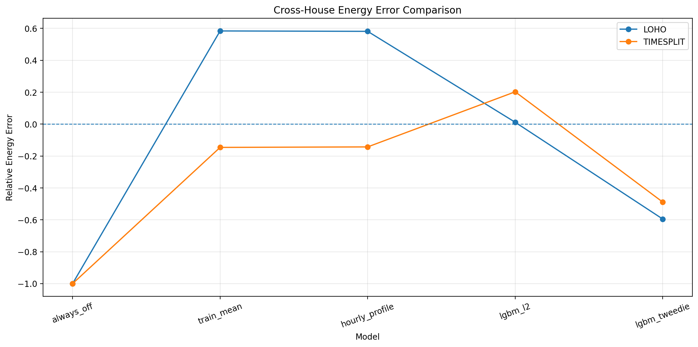

Compares relative energy estimation errors across models and evaluation strategies.
